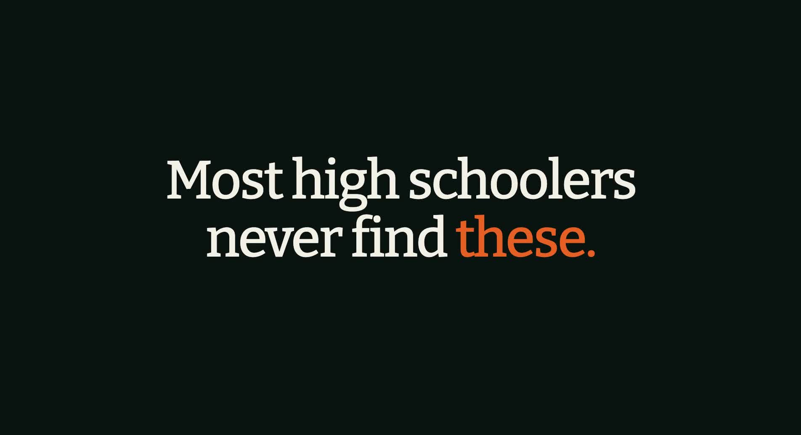

# Pathfind

### The opportunity list high schoolers wish they had in 9th grade.

72 programs, competitions, and internships, each linked straight to its official page. No signup, no spam, no guessing if you qualify.

[**Search all of it on Pathfind →**](https://getpathfind.com)

---

## Why this exists

Good opportunities for teens are scattered across hundreds of sites, deadlines pass quietly, and half the "lists" online are outdated or ads. Pathfind collects them in one place and checks each against the official program page.

This list is a free snapshot of the verified catalog. The full app adds filters by grade, interest and cost, and a **Build My Path** tool that turns your interests into a personal plan.

## How to read the list

- **Official source only:** every link goes to the organizer's own page.
- **Deadline:** a date means the organizer published it. `~` means an estimate from last cycle. `Next cycle TBA` means the last deadline passed and the new one is not out yet.
- **Always confirm** eligibility and dates on the official page before you apply.

## The list

_Snapshot from 2026-10-04. Live, always-current data is on [getpathfind.com](https://getpathfind.com)._

### Program (36)

| Program | Organizer | Grades | Cost | Deadline |
|---|---|---|---|---|
| [Babson Summer Study](https://www.babson.edu/summer-at-babson/high-school-learners/summer-study/) | Babson College | 10-11 | Paid | Rolling |
| [CMU AI Scholars](https://www.cmu.edu/pre-college/academic-programs/ai_scholars.html) | Carnegie Mellon University Pre-College Programs | 11-11 | Free | 2027-02-01 |
| [CMU CS Scholars](https://www.cmu.edu/pre-college/academic-programs/computer-science-scholars.html) | Carnegie Mellon University Pre-College Programs | 10-10 | Free | 2027-02-01 |
| [Cedars-Sinai Teen Volunteer Program](https://www.cedars-sinai.org/volunteer-services/high-school-students.html) | Cedars-Sinai | 9-12 | Paid | 2026-11-23 |
| [Children's Health Council Teen Volunteers](https://www.chconline.org/volunteer/) | Children's Health Council | 9-12 | Paid | Rolling |
| [Civil Air Patrol Cadet Program](https://www.gocivilairpatrol.com/programs/cadets) | Civil Air Patrol (U.S. Air Force Auxiliary) | 9-12 | Paid | Rolling |
| [Code in Place](https://codeinplace.stanford.edu/) | Stanford University | 8-12 | Free | Rolling |
| [Computer History Museum Teen Volunteer Interns](https://computerhistory.org/internships/) | Computer History Museum | 9-12 | Paid | Rolling |
| [Congress-Bundestag Youth Exchange (CBYX)](https://www.usagermanyscholarship.org/) | U.S. Department of State & German Bundestag | 9-12 | Paid | Rolling |
| [Cooper Union Summer STEM](https://cooper.edu/engineering/stem/summer) | The Cooper Union | 9-11 | Paid | Rolling |
| [Elements of AI](https://www.elementsofai.com/) | University of Helsinki and MinnaLearn | 8-12 | Free | Rolling |
| [Flight Teen Volunteers](https://www.hiller.org/join-and-support/volunteer/) | Hiller Aviation Museum | 9-12 | Paid | Rolling |
| [Gains in the Education of Mathematics and Science (GEMS)](https://www.usaeop.com/program/gems/) | Army Educational Outreach Program | 9-12 | Free | Rolling |
| [Girl Scout Gold Award](https://www.girlscouts.org/en/members/for-girl-scouts/badges-journeys-awards/highest-awards/gold-award.html) | Girl Scouts of the USA | 9-12 | Paid | Rolling |
| [Grammy Camp](https://www.grammymuseum.org/education/grammy-camp/) | Grammy Museum | 9-12 | Paid | Rolling |
| [Habitat for Humanity Youth Programs](https://www.habitat.org/volunteer/near-you/youth-programs) | Habitat for Humanity | 9-12 | Paid | Rolling |
| [Hampshire College Summer Studies in Mathematics (HCSSiM)](https://hcssim.org/) | HCSSiM | 9-12 | Paid | Rolling |
| [High School Investor Challenge](https://neeley.tcu.edu/degrees-programs/pre-college-programs/high-school-investor-challenge.php) | TCU Neeley School of Business | 11-11 | Paid | Rolling |
| [IBM SkillsBuild for High School Students](https://skillsbuild.org/students) | IBM | 8-12 | Free | Rolling |
| [JA Company Program](https://jausa.ja.org/programs/ja-company-program) | Junior Achievement USA | 9-12 | Paid | Rolling |
| [JA Titan](https://jausa.ja.org/programs/ja-titan) | Junior Achievement USA | 9-12 | Paid | Rolling |
| [MathILy](https://www.mathily.org/) | MathILy | 9-12 | Paid | Rolling |
| [NASA HUNCH](https://www.nasahunch.com/) | NASA | 9-12 | Paid | Rolling |
| [National Security Language Initiative for Youth (NSLI-Y)](https://www.nsliforyouth.org/) | U.S. Department of State | 9-12 | Paid | Rolling |
| [Neuroscience High School Scholars Program](https://eastonad.ucla.edu/about/neuroscience-high-school-scholars-program) | UCLA Mary S. Easton Center for Alzheimer's Research and Care | 10-11 | Free | Rolling |
| [Pathways Research Explorers (High School Explorers Program)](https://www.fredhutch.org/en/education-training/high-school-students/high-school-explorers-program.html) | Fred Hutchinson Cancer Center | 9-10 | Free | Rolling |
| [Polyphony Lit](https://www.polyphonylit.org/) | Polyphony Lit | 9-12 | Paid | Rolling |
| [Spirit of America Youth Leadership](https://foundingforward.org/students/spirit-of-america/) | Founding Forward | 9-12 | Paid | Rolling |
| [Summer Engineering Seminar (SES)](https://www.scu.edu/engineering/beyond-the-classroom/outreach/summer-engineering-seminar-ses/) | Santa Clara University School of Engineering | 10-11 | Free | Rolling |
| [Summer Environmental Interns](https://www.msnucleus.org/events/lam/environ_intern2026.html) | Math Science Nucleus | 10-12 | Free | 2027-04-15 |
| [Tar Heel Business Academy](https://www.kenan-flagler.unc.edu/pre-college-business-academy/) | UNC Kenan-Flagler Business School | 10-11 | Paid | 2026-11-16 |
| [The Junior Academy](https://www.nyas.org/programs/the-junior-academy/) | The New York Academy of Sciences | 9-12 | Free | Rolling |
| [Wharton Moneyball Academy](https://globalyouth.wharton.upenn.edu/programs/moneyball-academy/) | Wharton Global Youth Program, University of Pennsylvania | 11-12 | Paid | Rolling |
| [Whitney Youth Insights](https://whitney.org/education/teens) | Whitney Museum of American Art | 9-12 | Paid | Rolling |
| [Young Entrepreneurs Academy (YEA!)](https://yeausa.org/) | Young Entrepreneurs Academy | 9-12 | Paid | Rolling |
| [√mathroots](https://mathroots.mit.edu/) | MIT Department of Mathematics | 9-12 | Free | Rolling |

### Competition (24)

| Program | Organizer | Grades | Cost | Deadline |
|---|---|---|---|---|
| [Bennington Young Writers Awards](https://www.bennington.edu/events/young-writers-awards) | Bennington College | 9-12 | Free | Rolling |
| [Congressional Art Competition](https://www.house.gov/educators-and-students/congressional-art-competition) | U.S. House of Representatives | 9-12 | Paid | Rolling |
| [Cooke College Scholarship Program](https://www.jkcf.org/our-scholarships/college-scholarship-program/) | Jack Kent Cooke Foundation | 12-12 | Paid | 2026-11-11 |
| [Dream with Us High School Engineering Challenge](https://www.nasa.gov/directorates/armd/dream-with-us-high-school-design-challenge/) | NASA Aeronautics | 9-12 | Paid | 2026-12-08 |
| [Elks Most Valuable Student Scholarship](https://www.elks.org/scholars/scholarships/mvs.cfm) | Elks National Foundation | 12-12 | Paid | 2026-11-12 |
| [Essentially Ellington](https://www.jazz.org/ee/) | Jazz at Lincoln Center | 9-12 | Free | Rolling |
| [GENIUS Olympiad](https://geniusolympiad.org/) | Terra Science and Education (hosted by St. John Fisher University) | 8-12 | Paid | 2027-03-01 |
| [Global Stock Pitch Competition](https://yis.org/programs/stock-pitch-competition/) | Young Investors Society | 9-12 | Paid | 2027-02-19 |
| [High School Entrepreneurship and AI Video Pitch Competition](https://www.stevens.edu/school-business/high-school-entrepreneurship-and-artificial-intelligence-ai-video-pitch) | Stevens Institute of Technology School of Business | 9-11 | Paid | 2027-01-08 |
| [InvestWrite](https://www.investwrite.org/) | SIFMA Foundation | 9-12 | Paid | Rolling |
| [NASA TechRise Student Challenge](https://futureengineers.org/) | NASA and Future Engineers | 8-12 | Paid | 2026-11-02 |
| [National Personal Finance Challenge](https://www.councilforeconed.org/national-personal-finance-challenge/) | Council for Economic Education | 9-12 | Paid | Rolling |
| [Optimist International Essay Contest](https://www.optimist.org/member/scholarships3.cfm) | Optimist International | 9-12 | Paid | Rolling |
| [Optimist International Oratorical Contest](https://www.optimist.org/member/scholarships4.cfm) | Optimist International | 9-12 | Paid | Rolling |
| [Poetry Out Loud](https://www.poetryoutloud.org/) | National Endowment for the Arts & Poetry Foundation | 9-12 | Paid | Rolling |
| [President's Environmental Youth Award (PEYA)](https://www.epa.gov/education/presidents-environmental-youth-award) | U.S. Environmental Protection Agency | 9-12 | Paid | Rolling |
| [Princeton University Mathematics Competition (PUMaC)](https://pumac.princeton.edu/) | Princeton University | 9-12 | Paid | Rolling |
| [QuestBridge National College Match](https://www.questbridge.org/high-school-students/national-college-match) | QuestBridge | 12-12 | Paid | Rolling |
| [Ron Brown Scholar Program](https://www.ronbrown.org/) | Ron Brown Scholar Fund | 12-12 | Paid | Rolling |
| [Solar Car Challenge](https://www.solarcarchallenge.org/challenge/) | Solar Car Challenge Foundation | 9-12 | Paid | Rolling |
| [Stockholm Junior Water Prize (U.S.)](https://www.wef.org/resources/for-the-public/SJWP/) | Water Environment Federation | 9-12 | Paid | Rolling |
| [StudentCam](https://www.studentcam.org/) | C-SPAN | 9-12 | Paid | 2027-01-20 |
| [VFW Voice of Democracy](https://www.vfw.org/community/youth-and-education/youth-scholarships) | Veterans of Foreign Wars | 9-12 | Paid | Rolling |
| [Wharton High School Data Science Competition](https://globalyouth.wharton.upenn.edu/competitions/data-science-competition/) | Wharton Global Youth Program, University of Pennsylvania | 9-12 | Free | Rolling |

### Research (7)

| Program | Organizer | Grades | Cost | Deadline |
|---|---|---|---|---|
| [AEOP Internships and Fellowships](https://www.usaeop.com/program/reap/) | Army Educational Outreach Program | 9-12 | Free | Rolling |
| [Magee-Womens HS Summer Research Internship](https://mageewomens.org/for-researchers/education/high-school-summer-internship-program) | Magee-Womens Research Institute & Foundation | 10-11 | Paid | Rolling |
| [NIST Summer High School Intern Program (SHIP)](https://www.nist.gov/careers/student-opportunities/summer-high-school-intern-program) | National Institute of Standards and Technology | 11-12 | Paid | Rolling |
| [Northeastern Young Scholars Program (YSP)](https://stem.northeastern.edu/summer/ysp/) | Northeastern University Center for STEM Education | 11-11 | Free | 2027-03-01 |
| [Summer High School Advanced Research Program (SHARP)](https://www.unmc.edu/student-success/pathway-programs/sharp/index.html) | University of Nebraska Medical Center | 10-11 | Paid | 2027-02-01 |
| [UCSC Scholar Immersion Program (SIP)](https://sip.ucsc.edu/) | University of California, Santa Cruz | 9-12 | Paid | Rolling |
| [Van Andel Institute HS Graduate Research Program](https://www.vai.org/graduate-school/hs-program/) | Van Andel Institute | 12-12 | Paid | Rolling |

### Internship (5)

| Program | Organizer | Grades | Cost | Deadline |
|---|---|---|---|---|
| [One Summer Chicago](https://www.onesummerchicago.org/) | City of Chicago | 9-12 | Free | Rolling |
| [PYNtern Program](https://www.pyninc.org/workready) | Philadelphia Youth Network | 9-12 | Free | Rolling |
| [Summer Youth Employment Program (SYEP)](https://www.nyc.gov/site/dycd/services/jobs-internships/summer-youth-employment-program-syep.page) | NYC Department of Youth & Community Development | 9-12 | Free | Rolling |
| [TAG-Ed High School Summer Internship](https://tagedonline.org/high-school-summer-internship-program/) | TAG-Ed (Technology Association of Georgia Education Collaborative) | 10-11 | Paid | Rolling |
| [Youth Conservation Corps (YCC)](https://www.nps.gov/subjects/youthprograms/ycc.htm) | National Park Service | 10-12 | Free | Rolling |

## Missing one?

[Open an issue](../../issues) with the program name and its official link. Only programs with an official page are added.

## License

[MIT](LICENSE)

---

**Made by a student, for students.**

